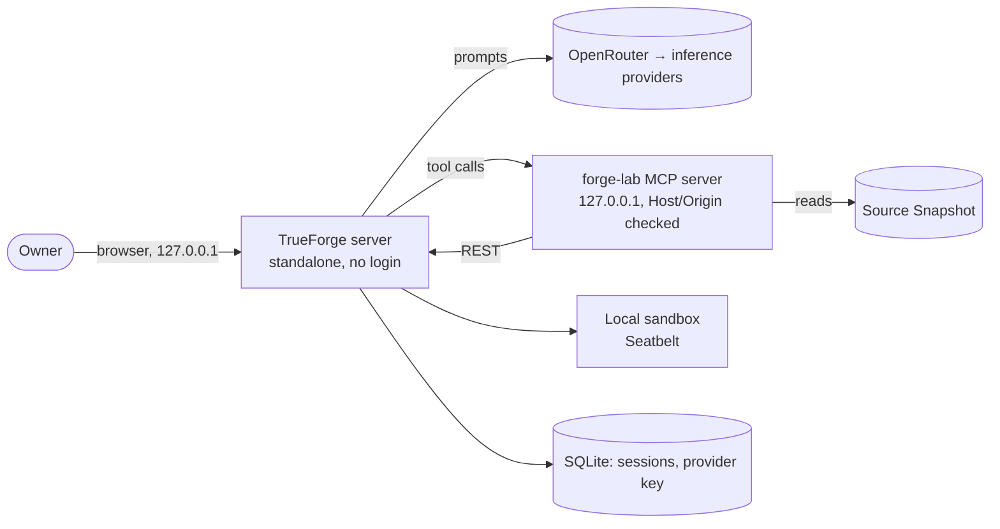

# Threat model — forge-lab

Living document. Update it when a new entry point, data store, external service or agent tool is added. Last reviewed: 2026-11-07. The detailed review of TrueForge itself is [research/security-review.md](research/security-review.md).

## 1. System overview

Everything runs on the owner's Mac, bound to `127.0.0.1`, and only while working. The trust boundaries are the loopback interface, OpenRouter, and GitHub (public issues and comments).

## 2. Assets

| Asset | Why it matters | Where it lives |
|---|---|---|
| API keys / secrets | Account takeover, spend | Secrets manager (see `secrets.md`) |
| OpenRouter key | Spend | root `.env`, then TrueForge's SQLite (unencrypted) |
| `CLAUDE_CODE_OAUTH_TOKEN` | the owner's Claude subscription | GitHub Actions secret |
| Session history | the owner's prompts and Experiments | TrueForge's SQLite |

## 3. Verification target

OWASP ASVS 5.0 level: **L1** _(raise to L2 when the app stores user data or has accounts)_.

## 4. Threats

Use STRIDE for the classic part. Status: open / mitigated / accepted.

| ID | Threat | Component | Mitigation | Status |
|---|---|---|---|---|
| T1 | Leaked secret in repo or logs | repo, CI | Gitleaks pre-commit + CI, GitHub push protection; secrets manager | mitigated |
| T2 | Malicious or compromised dependency | build | Lockfiles, 7-day cooldown, OSV-Scanner, Dependabot malware alerts | mitigated |
| T3 | Compromised GitHub Action | CI | Actions pinned to SHAs, `permissions: {}` default, zizmor | mitigated |
| T4 | Unreviewed change reaches main | repo | PR-only ruleset, `ci-ok` required, ADR 0002 | accepted (solo) |
| T5 | A web page drives TrueForge's API by DNS rebinding (no login, no Host check) | TrueForge | Loopback only; run the server only while working | accepted (upstream) |
| T6 | A stranger's issue or comment steers an agent with write access | CI review, local agents | Only `ZeleMate`'s text counts as instructions; the CI review reads owner/collaborator text only, and has no way to change the repo: it can only comment | mitigated |
| T7 | Code leaves the machine through the SonarQube MCP server | local agents | The hosted endpoint runs read-only (`SONARQUBE_READ_ONLY`) and only read tools are auto-allowed. Its analysis tool (`analyze_code_snippet`) sends the file content or snippet it is given to SonarQube; it is disabled on the hosted server and not allowed. The repo is public, and CI already sends the code to SonarQube Cloud | accepted |

## 5. Agentic threats

Edition-tagged: OWASP Top 10 for LLM Applications **2026**, OWASP Top 10 for Agentic Applications (**ASI**, Dec 2025). Fill in one row per relevant risk; delete rows that do not apply and say why.

| Risk | How it could happen here | Mitigation | Test / eval | Status |
|---|---|---|---|---|
| LLM01 Prompt Injection / ASI01 Agent Goal Hijack | Source files or session events steer Cartographer | Tool output treated as data; tool allowlist; Approval for every write | — (no eval suite yet) | open |
| LLM03 Excessive Agency / ASI02 Tool Misuse | Agent has broader tools than the task needs | Tool list in `agent-policy.md`; writes only on Experiment Sessions | `mcp/` unit tests | mitigated |
| ASI03 Identity & Privilege Abuse | Agent reuses user or service credentials | Scoped, short-lived credentials per tool | — | open |
| ASI04 Agentic Supply Chain | Malicious MCP server, tool definition or model | Pinned MCP servers and model IDs; reviewed tool definitions | — | open |
| ASI05 Unexpected Code Execution | Model-generated code runs on the host | TrueForge's Seatbelt sandbox: network allowlist, private `$HOME` | `harness/scripts/sandbox-check.ts` | mitigated |
| ASI06 Memory & Context Poisoning | Persisted memory stores attacker content | Provenance on memory entries; expiry; review | — | open |
| LLM06 Unbounded Consumption / ASI08 Cascading Failures | Loops or retries burn tokens or money | Dedicated OpenRouter key with a low credit limit | — | open |
| LLM08 Hidden Context Exposure | System prompt or secrets leak in output | No secrets in prompts; output filtering | eval: prompt-leak cases | open |
| LLM10 Improper Output Handling | Model output reaches shell/SQL/HTML | Schema validation before use; parameterised calls | unit tests | open |
| ASI09 Human-Agent Trust Exploitation | User approves a harmful action the agent framed as safe | Show exact action and diff before approval | — | open |

NIST SP 800-218A tasks covered: PW.1.1 (this section), PW.4.4 (pinned models/MCP), PW.5.1 (output validation), RV.1.1 (model I/O logging, see `slo.md`), RV.1.3 (SECURITY.md scope).

## 6. Accepted risks

| Risk | Why accepted | Revisit |
|---|---|---|
| No non-author review | Solo maintainer (ADR 0002) | When a second maintainer joins |
| Claude Code's `Read` deny rules for `.env*` and key files don't stop shell commands (`cat`, `python -c`) reading them | A `Bash(...)` deny list can't cover every way to read a file; Claude Code's sandbox is the real boundary | When the sandbox is enabled for this repo |
