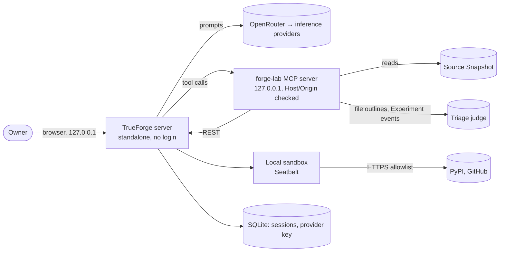

# Threat model — forge-lab

Living document. Update it when a new entry point, data store, external service or agent tool is added. Last reviewed: 2026-11-09. The detailed review of TrueForge itself is [research/security-review.md](research/security-review.md).

## 1. System overview

Everything runs on the owner's Mac, bound to `127.0.0.1`, and only while working. The trust boundaries are the loopback interface, OpenRouter, the triage judge (OpenAI's Decisions API, or `gpt-oss-20b` on OpenRouter), the sandbox's outbound allowlist, and GitHub (public issues and comments).

## 2. Assets

| Asset | Why it matters | Where it lives |
|---|---|---|
| OpenRouter key | Spend | root `.env`, then TrueForge's SQLite (unencrypted) |
| Triage judge's key | Spend | `mcp/.env`, read only by the MCP server |
| `CLAUDE_CODE_OAUTH_TOKEN` | the owner's Claude subscription | GitHub Actions secret |
| The owner's `gh` token | Full control of the owner's repos | macOS keychain; usable by any local agent with a shell |
| Session history | the owner's prompts and Experiments | TrueForge's SQLite |
| The owner's identity | Privacy on a public repo | Git metadata, recorded results |

`secrets.md` lists every secret and how it's rotated.

## 3. Verification target

OWASP ASVS 5.0 level: **L1** _(raise to L2 when the app stores user data or has accounts)_.

## 4. Threats

Use STRIDE for the classic part. Status: open / mitigated / accepted.

| ID | Threat | Component | Mitigation | Status |
|---|---|---|---|---|
| T1 | Leaked secret in repo or logs | repo, CI | Gitleaks pre-commit + CI, GitHub push protection; keys only in git-ignored `.env` files, the keychain or Actions secrets | mitigated |
| T2 | Malicious or compromised dependency | build | Lockfiles, 7-day cooldown, OSV-Scanner, Dependabot malware alerts | mitigated |
| T3 | Compromised GitHub Action | CI | Actions pinned to SHAs, `permissions: {}` default, zizmor | mitigated |
| T4 | Unreviewed change reaches main | repo | PR-only ruleset, `ci-ok` required, ADR 0002 | accepted (solo) |
| T5 | A web page drives TrueForge's API by DNS rebinding (no login, no Host check) | TrueForge | Loopback only; run the server only while working | accepted (upstream) |
| T6 | A stranger's issue or comment steers an agent with write access | CI review, local agents | Only `ZeleMate`'s text counts as instructions; the CI review reads owner/collaborator text only, and has no way to change the repo: it can only comment | mitigated |
| T7 | Code leaves the machine through the SonarQube MCP server | local agents | The hosted endpoint runs read-only (`SONARQUBE_READ_ONLY`) and only read tools are auto-allowed. Its analysis tool (`analyze_code_snippet`) sends the file content or snippet it is given to SonarQube; it is disabled on the hosted server and not allowed. The repo is public, and CI already sends the code to SonarQube Cloud | accepted |
| T8 | An outside PR's files run on the owner's Mac: `.claude/settings.json` hooks, `.mcp.json`, `lefthook.yml`, tests, or `AGENTS.md` steering an agent | local checkout | Outside PRs are read with `gh pr diff` and never checked out on the owner's machine (`AGENTS.md`, `CONTRIBUTING.md`); CI gives fork PRs no secrets and waits for approval | mitigated |
| T9 | The owner's email and hostname in public commits (2026-10-18 to 10-28), and the macOS username in old commits and a few Actions log lines | git history | Commits now use the noreply address. PR refs keep the old commits, so a rewrite can't fully remove them | open (owner's decision) |
| T10 | A recorded result brings the username back into the repo | `*-results/` | `saveResults` writes `/Users/<user>`; `hooks.ts no-home-paths` runs on commit and in CI | mitigated |

## 5. Agentic threats

Edition-tagged: OWASP Top 10 for LLM Applications **2025** (the numbering on [OWASP's list](https://genai.owasp.org/llm-top-10/)), OWASP Top 10 for Agentic Applications (**ASI**, Dec 2025). Renumber if the repo moves to a later LLM edition.

| Risk | How it could happen here | Mitigation | Test / eval | Status |
|---|---|---|---|---|
| LLM01 Prompt Injection / ASI01 Agent Goal Hijack | Source files or session events steer Cartographer | Tool output treated as data; web search off; Approval for every write. Nothing checks that the model obeys | — (no eval suite yet) | open |
| LLM02 Sensitive Information Disclosure | Injected text has Cartographer post the user's chats from a sandbox script: the allowlist includes `api.github.com`, `*.github.com` and `*.pypi.org`, can't be configured, and TrueForge's `exec` can't be gated, so an attacker's token is enough | Other chats: `get_turn`, `list_events` and `wait_turn` refuse them; `get_chat_turn` and `list_chat_events` are gated by name, so each call waits for an Approval, and TrueForge refuses them from sandbox code. **The conversation Cartographer runs in is always in its context, so it stays exposed**; closing that needs a sandbox without egress | `mcp/test/sessions-tools.test.ts`, `mcp/scripts/approvals-check.ts` (live: Approval pause, sandbox refusal, no marker leak) | open (current conversation only) |
| LLM02 Sensitive Information Disclosure | The user's chat reaches the triage judge | `check_events` refuses chats and their replays (`holdsChat`). `rank_relevance` sends snapshot outlines plus the model's own `question`, capped at 300 characters | `mcp/test/triage-tools.test.ts` | mitigated |
| LLM03 Supply Chain / ASI04 Agentic Supply Chain | Malicious dependency, MCP server or model | Exact pins, 7-day cooldown, no install scripts, attested snapshot pin; the MCP servers are this repo's; models are named in `apply-provider.ts`. `openrouter-auto` and DeepWiki (smoke tests only) are outside those pins, and Cartographer uses neither | `scripts/check-pins.ts`, CI | mitigated |
| LLM05 Improper Output Handling | Model output reaches a shell, path or tool call | zod on every tool input, paths kept inside the snapshot, ripgrep spawned without a shell, CI strips line breaks from findings | `mcp/` unit tests | mitigated |
| LLM06 Excessive Agency / ASI02 Tool Misuse | Agent has broader tools than the task needs | Tool list in `agent-policy.md`; writes only on Experiment Sessions, with Approval and depth limits | `mcp/` unit tests, `mcp/scripts/approvals-check.ts` | mitigated |
| LLM07 System Prompt Leakage | The prompt leaks in output | It is public in this repo and holds no secrets | — | accepted |
| LLM10 Unbounded Consumption / ASI08 Cascading Failures | Loops or retries burn tokens or money | Limits in `agent-policy.md`: 40 iterations, $0.50/day triage cap, 5 replayed Turns, write depth 2, no write retries, the key's credit limit | `mcp/test/triage-budget.test.ts` | mitigated |
| ASI03 Identity & Privilege Abuse | A local coding agent uses the owner's `gh` token, or an agent reads a key | Cartographer gets no credentials. Deny rules cover the common `gh` forms but can't cover every one, so the real limit is the token's scopes (`secrets.md`) | — | open (owner reduces the scopes) |
| ASI05 Unexpected Code Execution | Model-generated code runs on the host | TrueForge's Seatbelt sandbox: network allowlist, private `$HOME`, curated env | `harness/scripts/sandbox-check.ts`; the loopback probe hasn't had a live run yet | mitigated |
| ASI06 Memory & Context Poisoning | Injected text survives compaction or a replay into a later Turn | No long-term memory; replays carry only user messages | — | accepted |
| ASI07 Insecure Inter-Agent Communication | A Subagent's brief or result is tampered with | Subagents run inside one TrueForge process, with no agent-to-agent network. Treated as low risk from reading the code | — | accepted |
| ASI09 Human-Agent Trust Exploitation | User approves a harmful action the agent framed as safe | The Approval shows the tool and its exact arguments; writes reach only Experiment Sessions | `mcp/scripts/approvals-check.ts` | open (no eval of framing) |
| ASI10 Rogue Agents | An agent keeps acting outside its brief | Iteration and depth limits, Approvals, server runs only while working. The live check covers direct calls and sandbox code (TrueForge refuses Approval-gated tools there); Subagents aren't checked live, and "Subagents are read-only" is a prompt rule | `mcp/scripts/approvals-check.ts` | open (Subagents) |

Not applicable: LLM04 Data and Model Poisoning (nothing is trained), LLM08 Vector and Embedding Weaknesses (no RAG or embeddings), LLM09 Misinformation as a security risk (one reader, who checks the required citations; no eval yet).

NIST SP 800-218A tasks covered: PW.1.1 (this section), PW.4.4 (pinned models/MCP), PW.5.1 (output validation), RV.1.1 (model I/O stays in TrueForge's session events), RV.1.3 (SECURITY.md scope).

## 6. Accepted risks

| Risk | Why accepted | Revisit |
|---|---|---|
| No non-author review | Solo maintainer (ADR 0002) | When a second maintainer joins |
| Claude Code's `Read` deny rules for `.env*` and key files don't stop shell commands (`cat`, `python -c`) reading them | A `Bash(...)` deny list can't cover every way to read a file; Claude Code's sandbox is the real boundary | When the sandbox is enabled for this repo |
| The `gh` deny rules in `.claude/settings.json` can be sidestepped (a script, another flag order) | They stop mistakes, not a determined agent; the token's scopes are the limit | When the token's scopes change |
